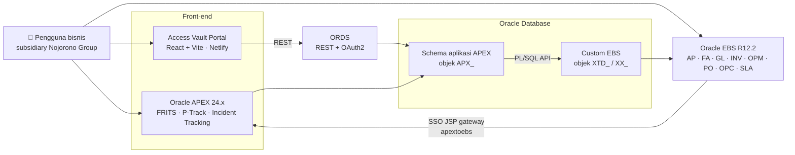
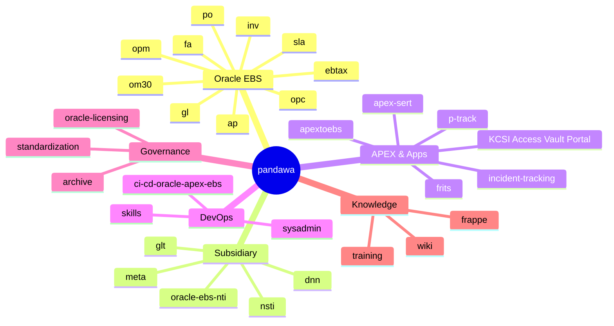
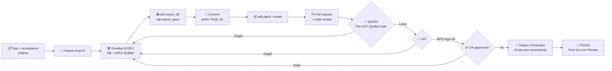
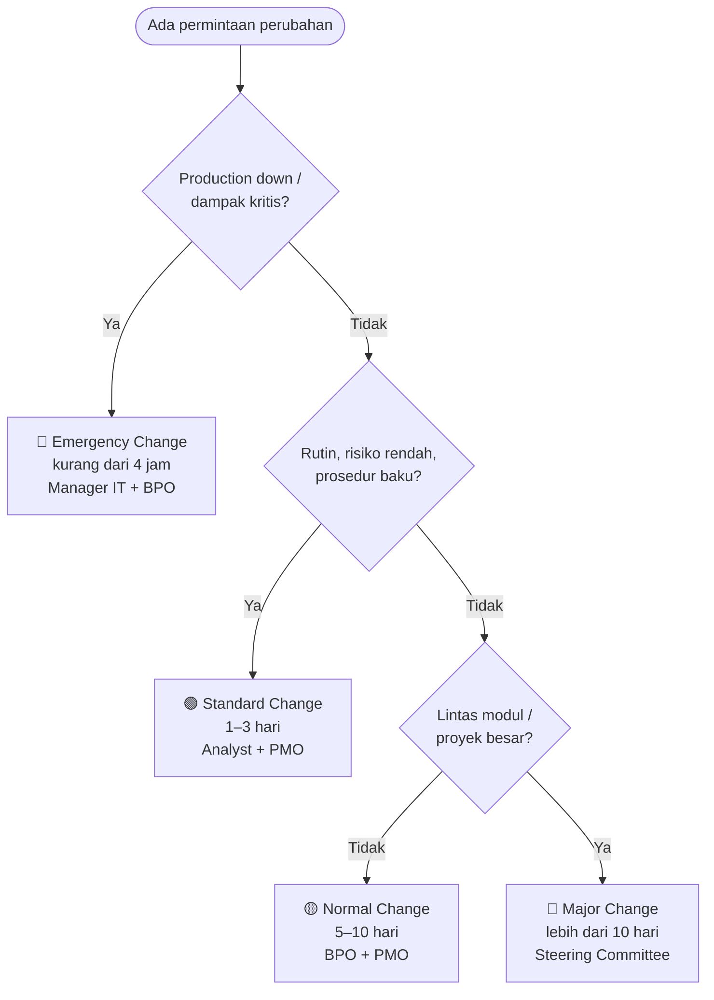

<div align="center">

# 🏛️ PANDAWA

**Monorepo Tim PANDAWA — IT Upstream Development**<br/>
KCSI (Karya Cipta Solusi Internasional) · Nojorono Group · Kudus, Jawa Tengah

[](LICENSE)
[](https://github.com/iwanhe/pandawa/commits/main)
[](#-aplikasi-apex-siap-install)
[](#-modul-oracle-ebs)
[](#️-arsitektur)
[](https://github.com/jkvetina/ADT)
[](#-claude-ai-skills-library)

</div>

> 🇬🇧 **In short:** PANDAWA is the central repository of an Oracle development team in Indonesia. It holds Oracle EBS R12.2 API scripts and customizations, ready-to-install Oracle APEX apps (installable through a Custom App Gallery), a full-stack ORDS-backed portal, an ADT-based CI/CD standard, governance documents, and a large library of Claude AI skills for Oracle development. Documentation is mostly in Bahasa Indonesia.

Repository pusat Tim PANDAWA untuk kode sumber, aplikasi APEX siap-install, tools, standar pengembangan, CI/CD pipeline, AI skills library, dan materi referensi seluruh project Oracle EBS & Oracle APEX di lingkungan Nojorono Group.

---

## 📑 Daftar Isi

- [Gambaran Umum](#-gambaran-umum)
- [Yang Baru](#-yang-baru)
- [Arsitektur](#️-arsitektur)
- [Peta Repository](#️-peta-repository)
- [Aplikasi APEX Siap-Install](#-aplikasi-apex-siap-install)
- [Claude AI Skills Library](#-claude-ai-skills-library)
- [Prasyarat](#️-prasyarat)
- [Quickstart](#-quickstart)
- [Alur Deployment](#-alur-deployment)
- [Change Management](#-change-management)
- [Coding Standards](#-coding-standards)
- [Bahasa Pemrograman](#-bahasa-pemrograman)
- [Roadmap](#️-roadmap)
- [Tim](#-tim)
- [Lisensi](#-lisensi)

---

## 📖 Gambaran Umum

| Area | Isi |
| --- | --- |
| 🏢 **Oracle EBS Customizations & API** | Script, package, dan dokumentasi untuk modul AP, FA, GL, INV, OPM, PO, OPC, SLA, dan E-Business Tax |
| 🧩 **Oracle APEX Applications** | Export aplikasi APEX internal (FRITS, P-Track/PERMADI, Incident Tracking) yang bisa di-install langsung, termasuk via *Custom App Gallery* |
| 🌐 **Full-stack Apps** | KCSI Access Vault Portal — React + Vite di Netlify, backend Oracle ORDS/PL/SQL |
| 🔄 **CI/CD Automation** | Standar deployment berbasis [ADT](https://github.com/jkvetina/ADT) & FNDLOAD untuk Dev → UAT → Production |
| 🌿 **Subsidiary Modules** | Kode & dokumentasi spesifik subsidiary Nojorono Group (NTI, NSTI, GLT, DNN) |
| 🤖 **Claude AI Skills Library** | Skill bundle untuk AI-assisted development (ADT, APEX, SQLcl, Oracle DB, standar PANDAWA) plus koleksi skill engineering/bisnis |
| 📐 **Standardisasi & Governance** | Standar pengembangan, naming convention, metodologi implementasi, change management policy, quality gate, dan analisis lisensi Oracle |

---

## 🆕 Yang Baru

| Tanggal | Perubahan |
|---------|-----------|
| Okt 2026 | **README baru**: diagram arsitektur, peta repo, alur deployment & change management (Mermaid), ringkasan English; `oracle-dev-standards.md` v1.0 dipindah ke `archive/` |
| Okt 2026 | Sinkronisasi README dengan kondisi repo: jumlah skill per koleksi, komposisi bahasa, versi APEX tiap app, submodule `oracons/` & `pandawa.wiki/` |
| Sep 2026 | **KCSI Access Vault Portal** — portal internal rekap data akses/koneksi (`KCSI_Access_Vault_Portal_Code/`) |
| Agu 2026 | **Oracle 23ai Free Capacity Check** — monitoring storage agar tidak mentok batas 12 GB (`oracle-licensing/oracle23ai-capacity-check/`) |
| Agu 2026 | **APEXlang skill** `apexlang-2026.08.01.zip` (`skills/`) |
| Jul 2026 | **OutSystems Log tool** — aplikasi APEX f105 (`meta/outsystem_log.zip`) |

<details>
<summary>Riwayat sebelumnya</summary>

| Tanggal | Perubahan |
|---------|-----------|
| Jun 2026 | Update dokumentasi lisensi Oracle (`oracle-licensing/`) |
| Mei 2026 | Skill `impeccable`, koleksi skill engineering/C-level/marketing/product/PM/RA-QM, Oracle Dev Standards v1.1 |
| Feb–Apr 2026 | Analisis lisensi Oracle APEX (v1.1–v1.3), komparasi 6 platform database, standar CI/CD, metodologi implementasi v2.1, dokumentasi EBS NTI |

</details>

---

## 🏗️ Arsitektur

Gambaran tingkat tinggi bagaimana komponen di repository ini saling terhubung.



---

## 🗺️ Peta Repository



<details>
<summary><b>📂 Detail struktur direktori</b> (klik untuk membuka)</summary>

### 📄 File root

| File | Deskripsi |
|------|-----------|
| `oracle-dev-standards-v1.1.md` | **Standar pengembangan Oracle — versi terkini (gunakan ini)** |
| `naming-convention-oracle.md` | Konvensi penamaan: prefix `XTD_` (EBS), `APX_` (APEX), dll. |
| `apps-implementation-methodology.md` | Metodologi implementasi aplikasi (berbasis Oracle AIM 3.0) |
| `Kebijakan_Manajemen_Perubahan_IT_Upstream_Development.md` | Change Management Policy — wajib dibaca semua developer |
| `custom_apps.json` | Registry *Custom App Gallery* APEX (P-Track & Incident Tracking) |
| `update-apex-component-modifier.ps1` | Script PowerShell untuk update skill APEX Component Modifier |
| `archive/oracle-dev-standards.md` | Standar pengembangan Oracle v1.0 (arsip, digantikan v1.1) |

### 🏢 Modul Oracle EBS

| Direktori | Modul | Isi |
|-----------|-------|-----|
| `ap/API Bank/` | Accounts Payable | Create Bank / Branch / Bank Account, assign ke Supplier Site & Pay Group |
| `ap/API Single Payment/` | Accounts Payable | Package `XX_AP_PAY_SINGLE_INVOICE_PKG` + dokumentasi |
| `ap/API Void Payment/` | Accounts Payable | Reverse/void check + dokumentasi |
| `ebtax/` | E-Business Tax | Setup tambahan EB-Tax NTI |
| `fa/` | Fixed Assets | API Create Accounting, Retirement, Calculate Gain/Loss, Mass Copy, Delete Asset, Explore Fiscal |
| `gl/reset-balance-gl/` | General Ledger | Script reset saldo GL + dokumentasi |
| `inv/inv-onhand-query/` | Inventory | Query on-hand per lot |
| `opc/work-confirmation/` | Project Costing | Cancel Work Confirmation dengan backup table |
| `opm/opm-costing/` | Process Manufacturing | Materi OPM costing & period end |
| `opm/opm-pd/` | Process Manufacturing | Create batch / recipe testing scripts |
| `po/autocreate po/` | Purchase Order | Troubleshooting DFF PR → PO autocreate |
| `po/reset/` | Purchase Order | Reset requisition & PO approval |
| `sla/` | Subledger Accounting | Query setup SLA NTI (ADR, AAD, JLD, JED, SLAM, custom source) |
| `om30/` | AIM Templates | Template dokumen Oracle AIM 3.0 (`AIM30/`) & PJM 2.6.1 (`PJM261/`) |

### 🌿 Subsidiary Modules

| Direktori | Entitas | Isi |
|-----------|---------|-----|
| `oracle-ebs-nti/` | PT NTI | 12 ringkasan dokumentasi EBS NTI: BP080 integrasi OPC/ITP/MPM/RRJ, training AP/INV/PO/OPC, project OPM restructure & relabelling |
| `nsti/ar/case-so-retur/` | PT NSTI | Penanganan kasus retur Sales Order & reinvoicing |
| `glt/` | PT Graha Lumbung Terpadu (tembakau) | Panduan APEX Mail Package untuk GLT App |
| `dnn/[DNN]_Application_Setup/` | DNN | Dokumen setup aplikasi AP, AR, CE, GL, PO, FA |
| `meta/po/` | META | Query penerimaan & ship confirm, solusi approve PO tanpa workflow |

> **KDK** (PT Karunia Daun Kencana — cengkih) dikelola di repository terpisah menggunakan schema `KDK` di Oracle ADB.

### 🏗️ Oracle APEX & Aplikasi

| Direktori | App | Deskripsi |
|-----------|-----|-----------|
| `frits/f216180/` | 216180 | **FRITS** — Form Request IT System (schema `WKSP_NTIAPPS`, export APEX 24.1.5, split + `install.sql` + `f216180.zip`) |
| `p-track/` | 114 | **P-Track / PERMADI** — Project tracking & monitoring (export APEX 24.2.11) |
| `incident-tracking/` | 101 | **Incident Tracking** — manajemen & tracking insiden IT (export APEX 24.2.11) |
| `meta/outsystem_log.zip` | 105 | OutSystems Log — aplikasi APEX untuk log viewer |
| `KCSI_Access_Vault_Portal_Code/` | — | **Access Vault Portal** — React 18 + Vite 5 + React Router (Netlify) dengan backend ORDS + OAuth2 & enkripsi AES-256 (schema `APX`, 5 script backend berurutan) |
| `apextoebs/` | — | Integrasi & SSO Oracle APEX ↔ Oracle EBS (JSP gateway `XXAPEXGWY.jsp`, Java `XXApexExternalAppManager`) |
| `apex-sert/` | — | APEX SERT 5.1 user guide & ringkasan security scanning |

### 🔧 DevOps & Infrastructure

| Direktori | Deskripsi |
|-----------|-----------|
| `ci-cd-oracle-apex-ebs/` | Standar CI/CD deployment Oracle APEX & EBS (ADT) dan panduan FNDLOAD R12.2 |
| `sysadmin/` | EBS Audit Scripts — 13 query SQL (audit setting, object/system privilege auditing, login & session per responsibility, PAT session, unsuccessful login) + 2 parser `awk` web usage — serta query password EBS |
| `skills/` | Claude AI skills library — lihat [bagian khusus](#-claude-ai-skills-library) |
| `oracons/` | Submodule (gitlink) tanpa `.gitmodules` — folder kosong saat di-clone; isi aslinya dikelola di luar repo ini |

### 📐 Standardization & Governance

| Direktori | Deskripsi |
|-----------|-----------|
| `standardization/` | Technical paper APEX-EBS Extension v4.3, Apps Implementation Methodology, Insum PL/SQL Guidelines, NTI Naming Conventions v3.3 |
| `standardization/2026/` | Dokumen 2026: BT010 Budget Tracking Dashboard, KPI Improvement Analysis, OW010 OWASP Compliance Checklist, PG010 Post Go-Live Review, QG010 Pre-UAT Quality Gate |
| `standardization/whitepaper/` | Whitepaper Omdia low/no/pro-code app dev platforms |
| `oracle-licensing/` | Analisis lisensi Oracle APEX (v1.1–v1.3), komparasi 6 platform database, materi licensing Oracle, SR Oracle Support |
| `oracle-licensing/oracle23ai-capacity-check/` | Script cek kapasitas manual & setup monitoring otomatis Oracle 23ai Free / XE |

### 📚 Knowledge & Training

| Direktori | Deskripsi |
|-----------|-----------|
| `training/Integration PO Distributor - SO Prinsipal/` | Materi integrasi PO Distributor ↔ SO Prinsipal, MD050 OM Ship Confirm v1.2, EUT script |
| `training/SQL Practice - Hands On/` | Materi & soal latihan SQL beserta ERD |
| `frappe/Dokumentasi Instalasi Frappe/` | Dokumentasi instalasi Frappe framework |
| [Wiki](https://github.com/iwanhe/pandawa/wiki) | GitHub Wiki repository (folder `pandawa.wiki/` di repo hanya pointer submodule ke wiki ini) |

</details>

---

## 📦 Aplikasi APEX Siap-Install

Aplikasi berikut tersedia dalam bentuk export `.sql` / `.zip` dan terdaftar di [`custom_apps.json`](custom_apps.json), sehingga bisa dipasang lewat **Custom App Gallery** APEX:

| App | Internal Name | Versi APEX | Source | Zip |
|-----|---------------|-----------|--------|-----|
| P-Track (PERMADI) | `P_TRACK` | 24.2.11 | [`p-track/f114.sql`](p-track/f114.sql) | [`p-track/f114.zip`](p-track/f114.zip) |
| Incident Tracking | `INCIDENT_TRACK` | 24.2.11 | [`incident-tracking/f101.sql`](incident-tracking/f101.sql) | [`incident-tracking/f101.zip`](incident-tracking/f101.zip) |

**Cara pakai:** di APEX Workspace → **App Gallery** → tambahkan URL raw berikut sebagai custom gallery:

```
https://raw.githubusercontent.com/iwanhe/pandawa/main/custom_apps.json
```

Atau install manual via SQLcl: `@p-track/f114.sql` dari workspace target.

---

## 🤖 Claude AI Skills Library

Folder `skills/` berisi skill bundle untuk AI-assisted development dengan Claude.

### Skill PANDAWA & Oracle

| File / Folder | Fungsi |
|---------------|--------|
| `adt.skill`, `adt-setup.skill` | Operasional & instalasi ADT (export, patch, deploy, recompile) |
| `apex.skill`, `apex/` | Export/patch/import komponen APEX via SQLcl (global patterns, references, tools) |
| `apex-component-modifier/`, `apex-component-modifier.zip`, `apex-component-modifier-SKILL.md` | Modifikasi komponen APEX (global/app patterns, evals, templates, tools) |
| `apex-qa-pandawa.skill` | Standar QA APEX PANDAWA (MVC, naming `APX_`, page design) |
| `apex-rest-pandawa.skill` | Standar REST/ORDS PANDAWA |
| `apex-sert.skill` | APEX SERT security evaluation & remediation |
| `apexlang-*.zip` | Skill APEXlang — terbaru `apexlang-2026.08.01.zip`; varian lama: `apexlang-skill-install.zip`, `apexlang-skill-slim.zip`, `apexlang-skill-slim-v2.zip` |
| `redwood-apex.skill` | Oracle Redwood Design System untuk APEX |
| `oracle-dev-standards.skill` | Standar development Oracle EBS & APEX PANDAWA |
| `upstream-change-management.skill` | Change Management Policy IT Upstream Development |
| `sqlcl.skill`, `sqlcl.zip`, `sqlcl/` | SQLcl & SQLcl MCP (references + templates) |
| `oracle-db/`, `oracle-db-skills.skill`, `oracle-db-skills-main.zip` | 150 referensi Oracle Database dalam 17 kategori (admin, agent, appdev, architecture, containers, design, devops, features, frameworks, migrations, monitoring, ORDS, performance, PL/SQL, security, SQL dev, SQLcl) |
| `impeccable-skill.zip` | Skill desain UI *impeccable* |

<details>
<summary><b>Koleksi skill umum</b> (±196 skill)</summary>

| Folder | Jumlah | Isi |
|--------|-------:|-----|
| `engineering/` | 48 | Advanced engineering (agent design, RAG, MCP server, CI/CD, database design, observability, release, runbook, dll.) |
| `engineering-team/` | 35 | Engineering per peran (architect, frontend, backend, fullstack, QA, DevOps, security, AI/ML, data, cloud AWS/Azure/GCP) |
| `c-level-advisor/` | 28 | Advisor C-level (CEO, CTO, CFO, CISO, COO, CPO, dll.), board meeting & board deck, M&A, change management |
| `marketing-skill/` | 44 | Content, SEO, CRO, paid ads, pricing, growth |
| `product-team/` | 16 | Product (RICE, agile PO, OKR, UX research) |
| `ra-qm-team/` | 13 | Regulatory & quality management (ISO 13485, ISO 27001, GDPR) |
| `project-management/` | 8 | PM (senior PM, scrum master, Jira, Confluence) |
| `finance/` | 3 | Financial analyst, business investment advisor, SaaS metrics coach |
| `business-growth/` | 1 | Business growth |

> Folder `_backup_apex_20260331_173517/` dan `_backup_oracle-db_20260428/` berisi snapshot skill lama sebelum update.

</details>

---

## ⚙️ Prasyarat

| Tool | Versi | Keterangan |
|------|-------|-----------|
| Oracle Database | 19c+ / 23ai | Target database utama |
| Oracle EBS | R12.2 | Untuk EBS customizations |
| Oracle APEX | 24.1 / 24.2 | Runtime aplikasi APEX (FRITS: 24.1, P-Track & Incident Tracking: 24.2) |
| ORDS | 23.4+ | Oracle REST Data Services |
| SQLcl | 24.x+ | CLI untuk Oracle, digunakan ADT & SQLcl MCP |
| Python | 3.10+ | Runtime ADT & automation scripts |
| [ADT](https://github.com/jkvetina/ADT) | Latest | APEX Deployment Tool — tool utama CI/CD |
| Node.js | 18+ | Build frontend Access Vault Portal (Vite) |
| PowerShell | 5.1+ | Deployment scripts (Windows) |
| Git | 2.x | Version control |
| Oracle Instant Client | 21c+ | Driver koneksi Oracle untuk Python |

---

## 🚀 Quickstart

**1. Clone repository**

```bash
git clone https://github.com/iwanhe/pandawa.git
cd pandawa
```

**2. Koneksi ke Oracle Database dengan SQLcl**

```bash
# Database on-premise (password akan diminta)
sql user@//host:port/service_name

# Autonomous Database dengan wallet
sql /nolog
SQL> set cloudconfig /path/to/wallet.zip
SQL> connect user@service_name_high
```

> 🔐 Jangan commit password, wallet, atau file koneksi ke repository ini.

**3. Menjalankan script PL/SQL**

```sql
-- Contoh: compile package AP Single Payment
@"ap/API Single Payment/XX_AP_PAY_SINGLE_INVOICE_PKG.pks"
@"ap/API Single Payment/XX_AP_PAY_SINGLE_INVOICE_PKG.pkb"

-- Contoh: cek kapasitas Oracle 23ai Free
@oracle-licensing/oracle23ai-capacity-check/oracle23ai-capacity-check/01_cek_kapasitas_manual.sql
```

**4. Deploy dengan ADT**

Instalasi ADT: lihat [jkvetina/ADT](https://github.com/jkvetina/ADT) atau skill `adt-setup.skill`.

```bash
adt export_db -recent 7                                      # objek DB yang berubah 7 hari terakhir
adt export_apex -app 216180 -only -split -readable -recent 0 # export aplikasi APEX
adt patch -target UAT -patch TASK_ID                         # preview commit yang cocok
adt patch -target UAT -patch TASK_ID -create -deploy         # buat & deploy patch ke UAT
```

Standar pipeline lengkap: [`ci-cd-oracle-apex-ebs/cicd_deployment_standard.md`](ci-cd-oracle-apex-ebs/cicd_deployment_standard.md)

**5. Access Vault Portal (development)**

```bash
# Backend: jalankan berurutan di schema APX
#   backend/01_schema.sql → 05_seed_lookup_data.sql
cd KCSI_Access_Vault_Portal_Code/frontend
npm install
npm run dev
```

Detail: [`KCSI_Access_Vault_Portal_Code/README.md`](KCSI_Access_Vault_Portal_Code/README.md)

---

## 🔄 Alur Deployment



### ✅ Checklist deployment

- [ ] Code review selesai
- [ ] Script sudah ditest di Dev
- [ ] Lolos Pre-UAT Quality Gate ([QG010](standardization/2026/QG010-Pre-UAT-Quality-Gate-Checklist_.md))
- [ ] UAT sign-off dari BPO
- [ ] Rollback script tersedia
- [ ] Change Request (CR) approved
- [ ] Deployment dilakukan di luar jam operasional (jika production)
- [ ] Post Go-Live Review ([PG010](standardization/2026/PG010-Post-GoLive-Review-Feedback.md))

---

## 🧭 Change Management



📄 Detail lengkap: [`Kebijakan_Manajemen_Perubahan_IT_Upstream_Development.md`](Kebijakan_Manajemen_Perubahan_IT_Upstream_Development.md)

---

## 📏 Coding Standards

Seluruh pengembangan **wajib** mengikuti [`oracle-dev-standards-v1.1.md`](oracle-dev-standards-v1.1.md) dan [`naming-convention-oracle.md`](naming-convention-oracle.md). Ringkasannya:

<table>
<tr>
<td valign="top">

**Prefix & suffix objek**

| Konteks | Pola | Contoh |
|---------|------|--------|
| EBS | `XTD_` | `XTD_AP_UTILS_PKG` |
| APEX | `APX_` | `APX_FRITS_PKG` |
| Package | `_PKG` | `XTD_GL_REPORT_PKG` |
| Procedure | `_PRC` | `XTD_AP_POST_PRC` |
| Function | `_FNC` | `XTD_INV_CALC_FNC` |
| View | `_V` | `XTD_PO_HEADERS_V` |
| Trigger | `_TRG` | `XTD_AP_INVOICE_TRG` |

</td>
<td valign="top">

**Variabel PL/SQL**

| Prefix | Tipe | Contoh |
|--------|------|--------|
| `l_` | Local | `l_vendor_name` |
| `g_` | Global | `g_org_id` |
| `k_` | Constant | `k_max_lines` |
| `p_` | IN param | `p_invoice_id` |
| `x_` | OUT param | `x_return_status` |
| `r_` | Record | `r_invoice` |
| `t_` | Collection | `t_line_ids` |
| `e_` | Exception | `e_invalid_amount` |

</td>
</tr>
</table>

**Style:** indentasi 3 spasi · SQL keyword lowercase · koma di depan kolom · anchored declaration (`%TYPE`, `%ROWTYPE`)

```sql
procedure post_invoice (
   p_invoice_id     in  ap_invoices_all.invoice_id%type
,  x_return_status  out varchar2
) is
   l_vendor_name  ap_suppliers.vendor_name%type;
begin
   select sup.vendor_name
     into l_vendor_name
     from ap_invoices_all inv
        , ap_suppliers    sup
    where inv.vendor_id  = sup.vendor_id
      and inv.invoice_id = p_invoice_id;

   x_return_status := 'S';
end post_invoice;
```

---

## 💻 Bahasa Pemrograman

| Bahasa | Porsi | Kegunaan |
|--------|------:|----------|
| Python | 77,5% | Tools & script pada skill library (`skills/`), automation scripts |
| PL/SQL & SQL | 17,8% | EBS API scripts, package, APEX application export, ORDS REST setup |
| JavaScript / JSX | 2,5% | Frontend React (Access Vault Portal), APEX dynamic actions |
| HTML / CSS | 0,6% | APEX templates, UI components |
| Java / JSP | 0,4% | Integrasi & SSO APEX ↔ EBS (`apextoebs/`) |
| PL/pgSQL · TypeScript | 0,7% | Contoh/integrasi pada koleksi skill engineering |
| Shell · Awk · PowerShell | 0,4% | Script deployment & setup (Windows), parsing log EBS (`sysadmin/`) |

> Data dari GitHub Linguist per Oktober 2026. Porsi Python didominasi oleh skill library (±345 file `.py`); kode inti PANDAWA sendiri mayoritas PL/SQL & SQL.

---

## 🗺️ Roadmap

- [x] CI/CD deployment standard (`ci-cd-oracle-apex-ebs/`)
- [x] Claude AI Skills library (`skills/`)
- [x] Change Management Policy
- [x] Oracle Dev Standards v1.1
- [x] APEX SERT security scanning setup
- [x] Analisis lisensi Oracle APEX & komparasi platform database
- [x] Custom App Gallery (`custom_apps.json`) untuk P-Track & Incident Tracking
- [x] Quality gate & OWASP compliance checklist (`standardization/2026/`)
- [x] Oracle 23ai Free capacity monitoring
- [x] KCSI Access Vault Portal
- [ ] Kesiapan upgrade Oracle APEX 26.1
- [ ] utPLSQL automated test suite per modul
- [ ] Docker containerized dev environment
- [ ] API documentation otomatis per package/function
- [ ] Wiki lengkap per modul EBS
- [ ] Security hardening checklist per APEX app
- [ ] Performance tuning guidelines

---

## 👥 Tim

**IT Upstream Development — Tim PANDAWA**

| | |
|---|---|
| **Organisasi** | KCSI — Karya Cipta Solusi Internasional |
| **Induk** | Nojorono Group |
| **Lokasi** | Kudus, Jawa Tengah |
| **Stack Utama** | Oracle EBS R12.2 · Oracle APEX 24.x · ORDS · PL/SQL · ADT · SQLcl · Python |

<a href="https://github.com/iwanhe/pandawa/graphs/contributors">
  
</a>

Pertanyaan, laporan bug, atau permintaan fitur → [buka GitHub Issue](https://github.com/iwanhe/pandawa/issues)

---

## 📄 Lisensi

Repository ini dilisensikan di bawah [MIT License](LICENSE). Bebas digunakan, dimodifikasi, dan didistribusikan dengan tetap mencantumkan atribusi yang sesuai.

> Skill pihak ketiga di folder `skills/` (mis. `oracle-db/`, koleksi engineering/marketing/dll.) mengikuti lisensi masing-masing sumbernya.

<sub>Terakhir diperbarui: 27 Oktober 2026</sub>
